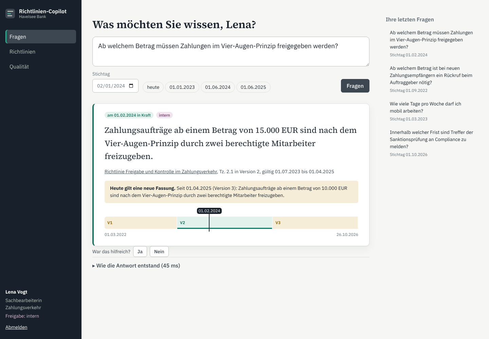

# bank-policy-copilot

An internal assistant that answers employees' questions about a bank's policies: **what applied
on a given date, citing the paragraph, using only documents the asker is allowed to read.**

The common enterprise RAG demo is a chatbot over a folder of PDFs. Real bank policies make that
unsafe in three ways:

- They change: last year's limit is not today's.
- They are classified, so a clerk must not learn the trading limits.
- A wrong number is worse than no answer.

This project is built around those three facts. It is meant for a German bank (German documents
and interface) and comes with the infrastructure it needs to run there.



## Results

The bank is simulated, so the correct answer to every question is known (see
`docs/adr/0006`). Blind sets were written by an author who saw only the documents and a brief,
never the code. A set's first run is recorded and never rewritten.

| question set | handled correctly | answerable, answered right | answers that were right | unanswerable, declined | wrong answers | leaks | median latency |
| --- | ---: | ---: | ---: | ---: | ---: | ---: | ---: |
| **blind v2, first run** (120) | **81.7 %** | **76.3 %** | **91.0 %** | **92.5 %** | 6 | **0** | 31 ms |
| blind v1, first run (120) | 78.3 % | 68.8 % | 91.7 % | 97.5 % | 5 | 0 | 34 ms |
| blind v1 today (now a regression set) | 91.7 % | 88.8 % | 93.4 % | 97.5 % | 5 | 0 | 34 ms |
| dev questions (211, generated from the rules) | 95.7 % | 93.8 % | 99.2 % | 98.8 % | 1 | 0 | 33 ms |

What the columns mean:

- **Handled correctly**: the right value from the right paragraph of the version in force on the
  date; or no answer when none is allowed or exists.
- **Leaks**: any paragraph from a document the asker may not read appearing in the answer, its
  citations or the evidence. The release gate fails on a single leak.

What the results show:

- **Retrieval is not the bottleneck.** The right paragraph is among the evidence for 97.5 % of
  blind v2's answerable questions.
- **Most misses are declines, not wrong answers.** The deciding model is tuned so that wrong
  answers stay rare.
- **Without any API key, the system runs fully extractive**, and that mode is what these numbers
  measure. With Claude configured, a verifier checks every number the model writes against the
  cited paragraph before showing it (`docs/adr/0003`).

| suite | tests |
| --- | ---: |
| backend (`pytest`, PostgreSQL + pgvector) | 31 |
| web (`vitest`, components and the ask flow) | 10 |
| end to end (Playwright, desktop and mobile) | 8 specs × 2 viewports |

## What it does

- **Ask with a date.** The answer quotes the paragraph from the version in force on that date,
  with its validity period. If the rule has changed since, it says what applies today. A band
  shows every version of the policy on a time axis.
- **Rights before retrieval.** Postgres row-level security enforces classification and audience
  before anything is ranked or sent to a model (`docs/adr/0001`).
- **Models by classification.** A registry says which model may see which classification and
  where it runs. Personal data is removed from questions before they are stored or sent.
- **Audit trail.** Every question and answer is linked in a hash chain the application cannot
  rewrite. Internal Audit can verify it.
- **Supervisory changes.** When a circular changes, the copilot finds the internal paragraphs
  that implement it and shows whether and when they were updated.
- **Feedback loop.** An answer marked "not helpful" goes to a Compliance review queue.
- **Documents.** Every readable policy with its versions, and a diff between versions.

## Architecture

```
document export (DMS: Word, PDF; wiki: HTML; regulatory feed)  + identity export (users, groups, clearance)
        │ parse (Tz. paragraphs, header: number, version, date of effect, classification)
        ▼
PostgreSQL 17  ── documents ─ versions (valid_from, valid_to) ─ paragraphs (tsvector german, vector(384))
   row-level security on every tenant table · hash-chained queries · impact items · feedback
        ▲ as_user(login → clearance, groups)
FastAPI ── retrieve (full text + vectors, filtered by date and rights) → features → answerability model
        └─ route by classification → extractive quote | Claude (verified) → audit chain
React 19 web app ── ask · documents/diff · review · quality
copilot_sim (outside the platform) ── simulated bank, truth, dev/blind questions, evaluation, training
```

Decisions are recorded in `docs/adr/`:

1. Rights before retrieval
2. Answers as of a date
3. Retrieval, the decision to answer, and model routing
4. Audit trail
5. Supervisory change impact
6. Evaluation with blind sets
7. Frontend

## Run it

With Docker:

```sh
docker compose up -d --build
docker compose --profile demo run --rm seed      # renders and ingests the simulated bank
open http://localhost:8080                       # sign in as one of the demo employees
```

For development (Python 3.12+, Node 22, PostgreSQL with pgvector):

```sh
python -m venv .venv && .venv/bin/pip install -e "backend[dev,sim]"
cd backend
python -m copilot_sim seed                       # migrate, export the bank, ingest
COPILOT_DEMO_MODE=true uvicorn copilot.api.app:create_app --factory --port 8000
cd ../web && npm ci && npm run dev               # http://localhost:5173
```

Tests and evaluation:

```sh
cd backend && ruff check src tests && mypy && pytest -q   # db tests: COPILOT_TEST_ADMIN_URL
python -m copilot_sim evaluate && python -m copilot_sim gate
cd ../web && npm run lint && npm run typecheck && npm test && npx playwright test
```

## Deploy

- **Images:** `backend/Dockerfile` (API, and a tools image for seeding and evaluation) and
  `web/Dockerfile` (unprivileged nginx serving the app and proxying `/api`, with a content
  security policy).
- **Azure (`deploy/terraform`):**
  - Container Apps in a virtual network. The API is internal-only; the web app is the only
    public entry.
  - PostgreSQL Flexible Server, private, zone-redundant, with pgvector allow-listed.
  - A container registry pulled with a managed identity.
  - A Container Apps job that runs migrations.
  - Region: Germany West Central.
- **CI (`.github/workflows/ci.yml`):** backend and web checks, a seeded stack with the evaluation
  gate and Playwright, `terraform validate`, image builds and a smoke test of the built images.

## Settings

- **Environment:** `COPILOT_DATABASE_URL`, `COPILOT_ADMIN_DATABASE_URL`, `COPILOT_TOKEN_SECRET`,
  `COPILOT_DEMO_MODE`, `COPILOT_METRICS_TOKEN`, `ANTHROPIC_API_KEY` (optional).
- **Thresholds and vocabulary** live in `config/`:
  - `retrieval.yaml`
  - `models.yaml` (the model registry)
  - `thesaurus.yaml`
  - `answerability.json` (trained)

## Limits

- **The data is simulated.** 21 policies and 2 circulars of an invented bank; real policy sets
  are larger and messier.
- **Demo sign-in.** Sign-in is a demo picker; production would put the bank's identity provider
  (OIDC) in front and keep the same rights model.
- **Coverage.** About a quarter of answerable blind questions get no answer, mostly on very
  conversational wording. An LLM reader behind the existing verifier is the next step. Its
  answers are not part of the measured numbers, because none of the runs used an API key.
- **German only.** Questions in English are not translated.
- **Database TLS.** The Azure connection string encrypts (`sslmode=require`) but does not verify
  the server certificate; production should use `verify-full` with the Azure CA bundle.
